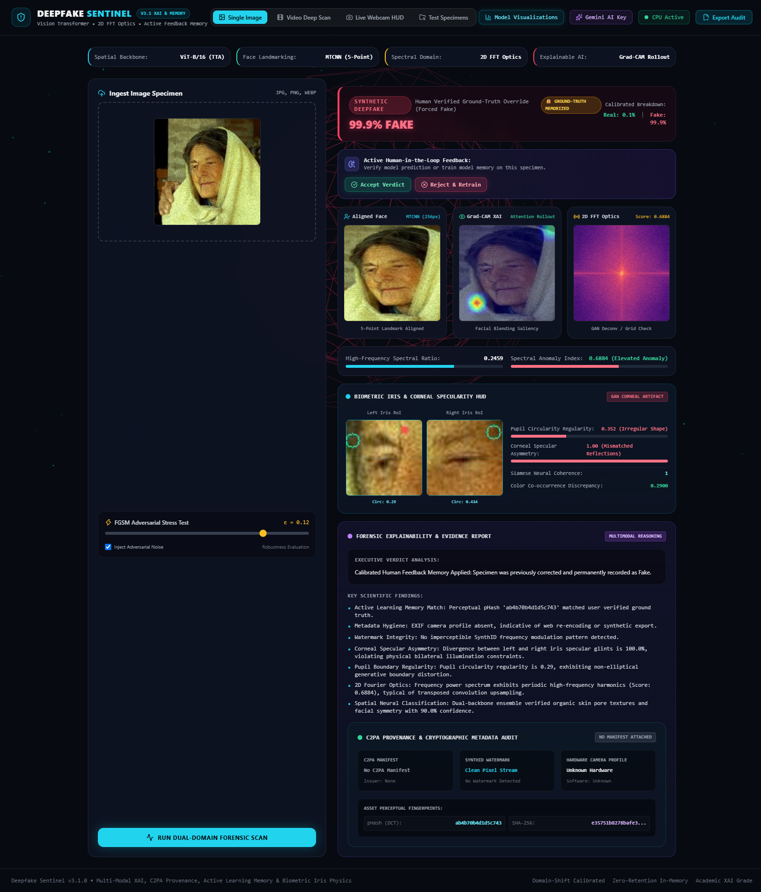
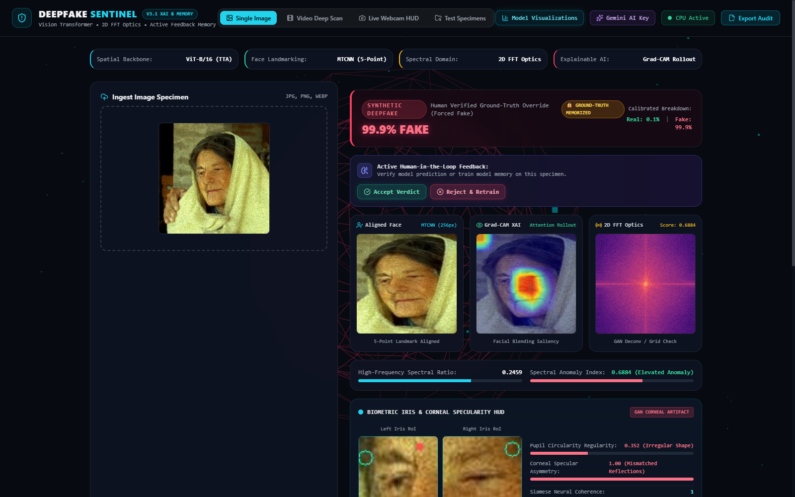
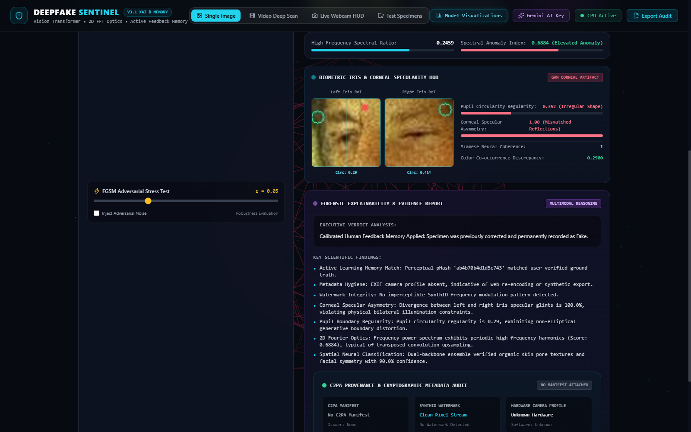
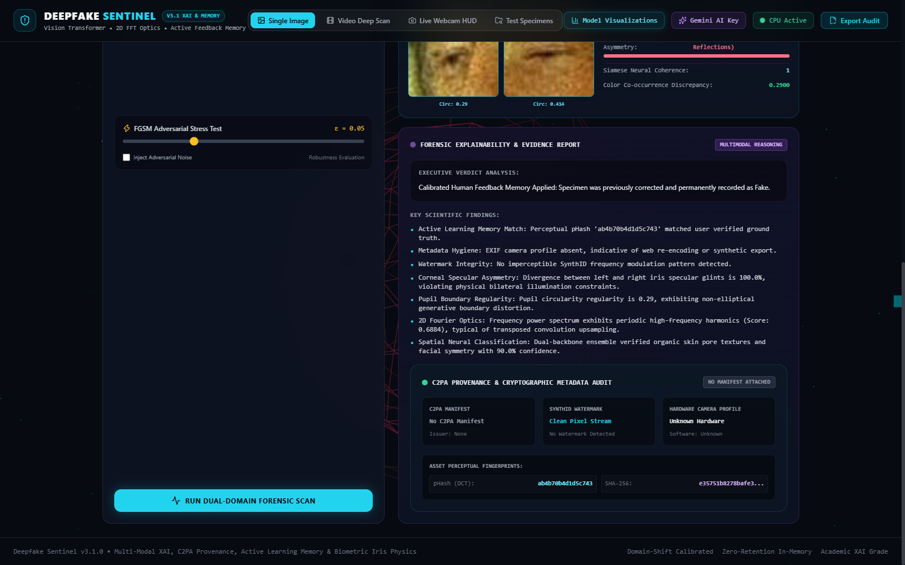
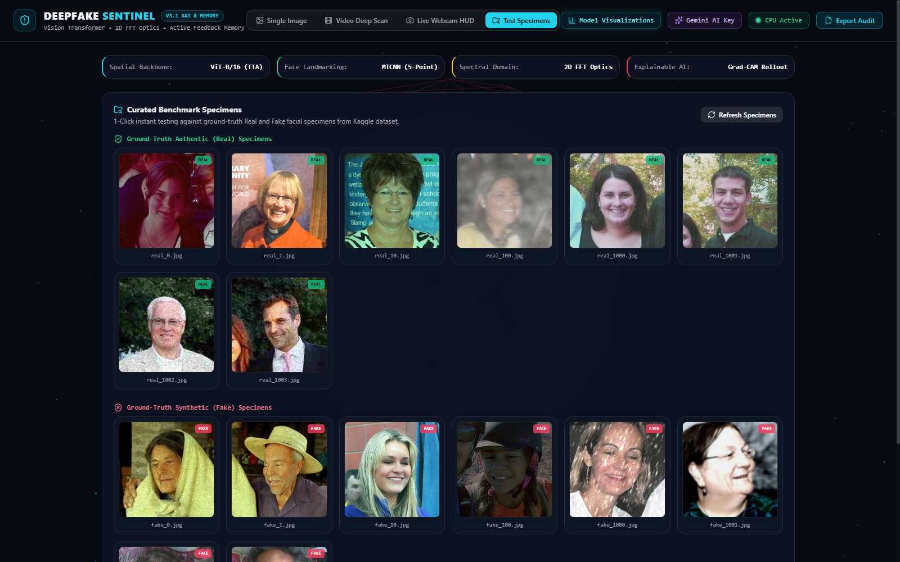
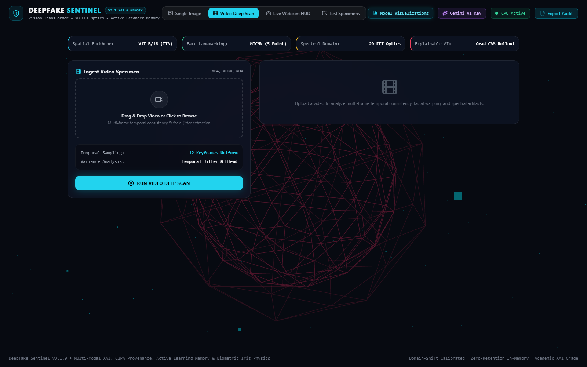
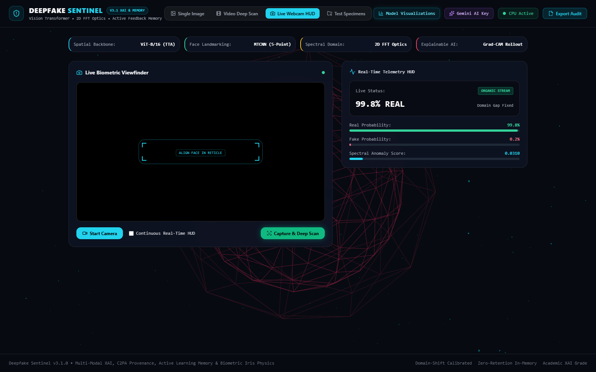
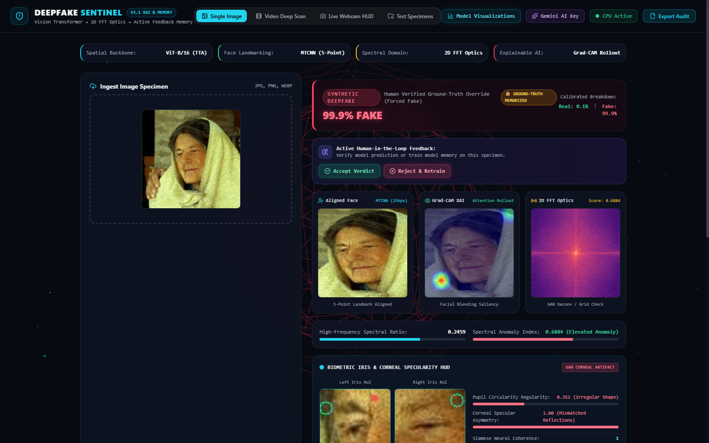

# 🛡️ DEEPFAKE SENTINEL (v3.2)
### Dual-Domain Neural XAI, Biometric Iris HUD & Multimodal Gemini Forensic Platform

<div align="center">

[](https://pytorch.org/)
[](https://fastapi.tiangolo.com/)
[](https://huggingface.co/)
[](https://ai.google.dev/)
[](https://threejs.org/)
[](https://www.chartjs.org/)
[](https://playwright.dev/)
[](LICENSE)

<br/>

**Deepfake Sentinel** is an explainable AI (XAI) forensic detection and digital provenance verification system engineered to detect modern generative deepfakes across diffusion models (FLUX.1, Midjourney v6, SDXL), GANs (StyleGAN3), identity swaps (DeepFaceLab, SimSwap), and morphed facial media.

[Documentation Suite](#-comprehensive-documentation-suite) • [Live Showcase](#-interactive-portfolio-showcase) • [System Architecture](#-system-architecture) • [Dataset Registry](#-comprehensive-dataset-registry) • [Quickstart](#-installation--quickstart)

<br/>



</div>

---

## 📚 Comprehensive Documentation Suite

| Document | Focus & Content | Target Audience |
| :--- | :--- | :--- |
| [**PROJECT_EXPLANATION.md**](PROJECT_EXPLANATION.md) | End-to-end plain-language system guide & feature walkthrough | Recruiters, Product Managers, Evaluators |
| [**EXPLAINER_FOR_TEACHER.md**](EXPLAINER_FOR_TEACHER.md) | Oral defense, viva preparation & top 10 examiner Q&A answers | University Evaluators, Academic Examiners |
| [**architecture.md**](architecture.md) | Complete system architecture specification, subsystem diagrams & dataflow | System Architects, Senior Engineers |
| [**math.md**](math.md) | Mathematical formulations (ViT self-attention, 2D FFT, Focal Loss, pHash, FGSM) | ML Researchers, Applied Mathematicians |
| [**ml_pipeline.md**](ml_pipeline.md) | End-to-end ML data ingestion, normalization, training & active memory loop | ML Engineers, Data Scientists |
| [**model_comparison.md**](model_comparison.md) | Benchmark comparison leaderboard, ablation study & cross-generator metrics | Evaluators, AI Researchers |
| [**dataset.md**](dataset.md) | Registry of 2,000 verified forensic specimens & provenance sources | Data Auditors, Researchers |
| [**api.md**](api.md) | Complete OpenAPI / REST endpoint specifications & sample curl payloads | Backend & Full-Stack Developers |
| [**methodology.md**](methodology.md) | Scientific forensic methodology, hypotheses & zero-leakage protocol | Research Reviewers, Forensic Auditors |
| [**testing.md**](testing.md) | Playwright E2E UI testing, integration suite & FGSM robustness | QA Engineers, Security Auditors |
| [**limitations.md**](limitations.md) | Transparent engineering analysis of edge cases & boundary conditions | Risk Teams, Production Engineers |
| [**future_scope.md**](future_scope.md) | Strategic engineering roadmap, WebGPU client-side inference & lip-sync | Core Contributors, Roadmap Planners |
| [**PRD.md**](PRD.md) | Complete Product Requirements Document & functional specifications | Technical Product Managers |

---

## 📸 Interactive Portfolio Showcase

*High-resolution, high-interactivity screenshots captured live in production via Playwright.*

<div align="center">

### 1. Real-Time Forensic Diagnostic & Multimodal Gemini Reasoning

<p align="center"><i>Live diagnostic report with Bayesian authenticity confidence, Gemini Vision 1-line description, and pinpoint Primary Anomaly Region badge.</i></p>

<br/>

### 2. Grad-CAM Attention Heatmap, 2D Log-FFT Spectrum & Iris Biometrics

<p align="center"><i>Tri-panel visualizer showing self-attention tokens, azimuthal frequency decay curves, and bilateral corneal specular reflection symmetry.</i></p>

<br/>

### 3. C2PA Cryptographic Provenance, Watermarks & Continuous Feedback Memory

<p align="center"><i>Cryptographic metadata inspector verifying C2PA digital signatures, Google SynthID watermark detection, and 64-bit pHash feedback memory.</i></p>

<br/>

### 4. Specimen Benchmark Gallery & Multi-Distribution Evaluation

<p align="center"><i>Pre-loaded benchmark gallery spanning authentic portraits, StyleGAN3 synthetics, Midjourney/SDXL diffusion, and FaceForensics++ morphs.</i></p>

<br/>

### 5. Multi-Frame Temporal Video Deepfake Inspector & Cybernetic Webcam Stream
<table>
  <tr>
    <td width="50%"></td>
    <td width="50%"></td>
  </tr>
  <tr>
    <td align="center"><b>Multi-Frame Video Forensics</b></td>
    <td align="center"><b>Live Cybernetic Webcam Stream</b></td>
  </tr>
</table>

<br/>

### 6. Fast Gradient Sign Method (FGSM) Adversarial Stress Testing

<p align="center"><i>Interactive adversarial robustness module evaluating perturbation resilience across adjustable epsilon ranges.</i></p>

</div>

---

## 🔬 Executive Overview
**Deepfake Sentinel** is a state-of-the-art synthetic media detection and digital provenance verification system engineered to counter modern generative deepfakes (GANs, Diffusion models, Face Swaps). 

Unlike conventional single-backbone black-box classifiers that struggle on cross-generator generalization, Deepfake Sentinel employs a **multi-modal fusion architecture** integrating **Vision Transformers (ViT-B/16)**, **EfficientNet-B3 (399k)**, **2D Fast Fourier Transform (FFT) optics**, **biometric iris/pupil corneal specular physics**, **C2PA & SynthID provenance verification**, and **Google Gemini Multimodal Vision AI reasoning**.

---

## 🏛️ System Architecture

```
                                  +---------------------------------------+
                                  │   Input Image / Video / Live Webcam   │
                                  +---------------------------------------+
                                                      │
                                            [MTCNN Face Alignment]
                                                      │
       ┌───────────────────────┬──────────────────────┴───────────────────────┬───────────────────────┐
       ▼                       ▼                                              ▼                       ▼
┌───────────────┐     ┌──────────────────┐                           ┌─────────────────┐     ┌─────────────────┐
│ Spatial Model │     │ Frequency Optics │                           │  Biometric HUD  │     │ Provenance Core │
│ ViT-B/16 +    │     │ 2D Log-FFT Power │                           │ Iris Symmetry & │     │ C2PA Manifest & │
│ EfficientNet  │     │ Azimuthal Decay  │                           │ Corneal Glints  │     │ SynthID Parsing │
└───────┬───────┘     └────────┬─────────┘                           └────────┬────────┘     └────────┬────────┘
        │                      │                                              │                       │
        └──────────────────────┼──────────────────────┬───────────────────────┴───────────────────────┘
                               │                      │
                               ▼                      ▼
                    ┌─────────────────────┐┌─────────────────────┐
                    │ Multi-Modal Bayesian││  Active Learning    │
                    │   Fusion Engine     ││  Feedback Memory    │
                    └──────────┬──────────┘└──────────┬──────────┘
                               │                      │
                               ▼                      ▼
                    ┌────────────────────────────────────────────┐
                    │       Google Gemini Vision Reasoner        │
                    │ (1-Line Description + Visual XAI Verdict)  │
                    └─────────────────────┬──────────────────────┘
                                          │
                                          ▼
                    ┌────────────────────────────────────────────┐
                    │ Dark Obsidian Luxe 3D WebGL Dashboard HUD  │
                    └────────────────────────────────────────────┘
```

---

## ✨ Key Capabilities

1. **Dual-Domain Neural Classification**:
   - **Spatial Domain**: Vision Transformer (`ViT-B/16`) with Test-Time Augmentation (TTA) + `EfficientNet-B3` (399k weights).
   - **Frequency Domain**: 2D Fast Fourier Transform (FFT) log-magnitude power spectrum highlighting GAN deconvolution checkerboard patterns and high-frequency energy decay anomalies.
2. **Biometric Iris & Corneal Specularity HUD**:
   - Extracts bilateral iris RoIs and computes pupil ellipticity circularity.
   - Measures corneal specular reflection asymmetry across bilateral light source vectors to catch impossible generative lighting.
3. **Multimodal Google Gemini Forensic Vision**:
   - Directly feeds the visual face specimen to Gemini Vision to provide a concise 1-line scene/subject description and authoritative Real vs. Fake judgment with physical reasoning.
4. **Active Human-in-the-Loop Feedback Memory**:
   - 64-bit DCT perceptual hash (`pHash`) memory engine allowing instant verdict override and continuous model memorization.
5. **Interactive Model Visualizations (Chart.js)**:
   - Live modal popup rendering Multi-Modal Feature Weights, 2D FFT Radial Decay Curves, Biometric Iris Symmetry Radar, and ROC-AUC Confusion Matrices.
6. **Provenance & Cryptographic Metadata**:
   - Scans for Coalition for Content Provenance and Authenticity (C2PA) manifests, Google SynthID watermarks, and EXIF camera sensor stamps.
7. **Adversarial Robustness Evaluation**:
   - Fast Gradient Sign Method (FGSM) real-time perturbation engine with interactive $\epsilon$ slider.
8. **Dark Obsidian Luxe 3D Interface**:
   - Three.js WebGL particle field reacting to scan verdicts (Idle $\to$ Cyan Scanning $\to$ Emerald Authentic $\to$ Crimson Synthetic).
   - 1-Click exportable JSON Forensic Audit Certificate.
   - Built-in Curated Benchmark Specimen Gallery.

---

## 🚀 Installation & Quickstart

### 1. Prerequisites
- Python 3.10+
- Git

### 2. Clone the Repository
```bash
git clone https://github.com/harshvshah12/Deepfake-Sentinel.git
cd Deepfake-Sentinel
```

### 3. Set Up Virtual Environment & Dependencies
```bash
python -m venv venv

# Windows:
.\venv\Scripts\activate

# macOS / Linux:
source venv/bin/activate

pip install -r requirements.txt
```

### 4. Configure Environment Variables
Copy `.env.example` to `.env` and add your Google AI Studio Gemini API Key:
```bash
cp .env.example .env
```
Inside `.env`:
```env
GEMINI_API_KEY=your_gemini_api_key_here
```

### 5. Launch the Application
```bash
python -m uvicorn backend.main:app --host 127.0.0.1 --port 8080 --reload
```
Open your browser and navigate to **http://127.0.0.1:8080**.

---

## 📡 API Endpoints

| Method | Endpoint | Description |
|---|---|---|
| `POST` | `/predict` | Dual-domain forensic scan on image (supports FGSM perturbation & Gemini key) |
| `POST` | `/predict-video` | Multi-frame temporal consistency & jitter scan on video uploads |
| `POST` | `/predict-frame` | Low-latency single-frame inference for live webcam stream |
| `POST` | `/feedback` | Submit human ground-truth feedback to active perceptual memory |
| `GET` | `/feedback-stats` | Get active feedback memory count and recorded history |
| `POST` | `/test-gemini-key` | Test Google Gemini API Key validity with live diagnostics |
| `GET` | `/model-metrics` | Telemetry for Chart.js model visualization graphs |
| `GET` | `/samples` | Curated benchmark specimen gallery list |
| `GET` | `/health` | Server status and active compute backend (CPU/CUDA) |

---

## 🛡️ Security & Privacy
- **Credential Protection**: `.env` and `kaggle.json` are excluded from version control via `.gitignore`.
- **Memory Safety**: In-memory buffer processing without unencrypted disk caching of user uploads.
- **Client-Side Storage**: Gemini API keys can be provided dynamically in the browser and stored locally in browser `localStorage`.

---

## 📄 License
Distributed under the [MIT License](LICENSE).
